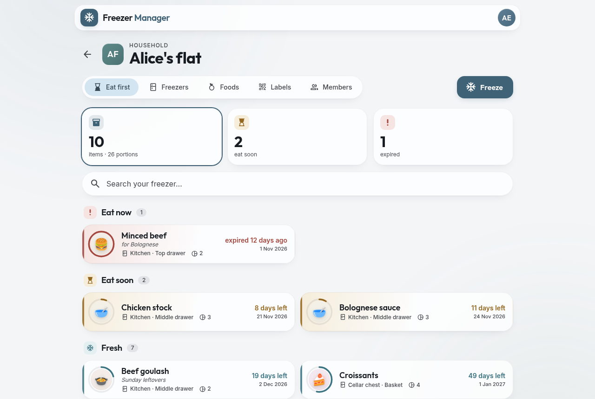
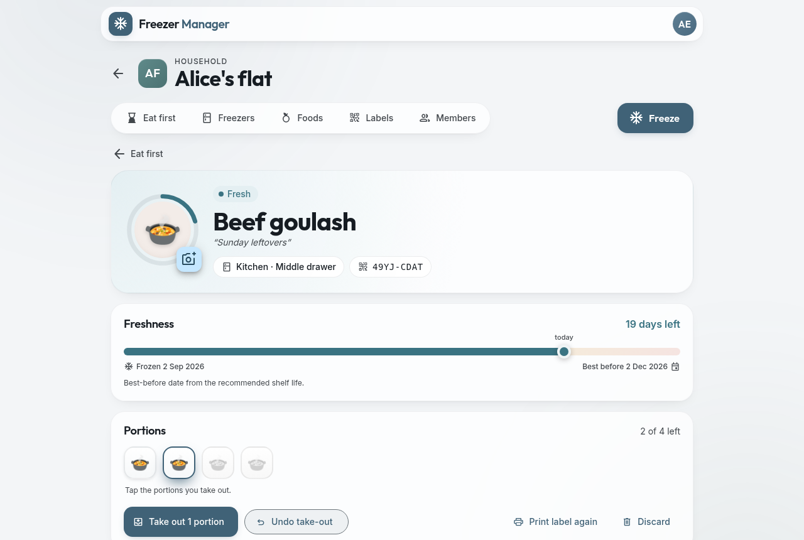
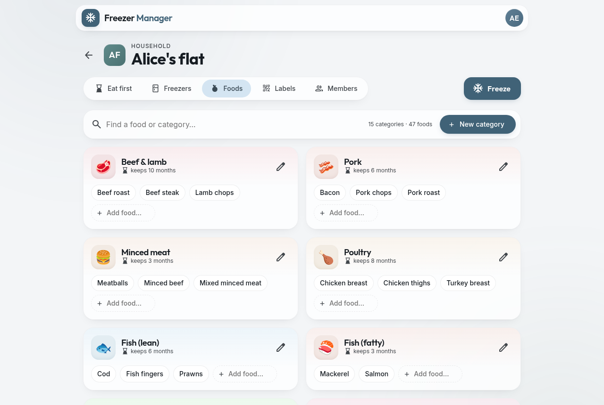
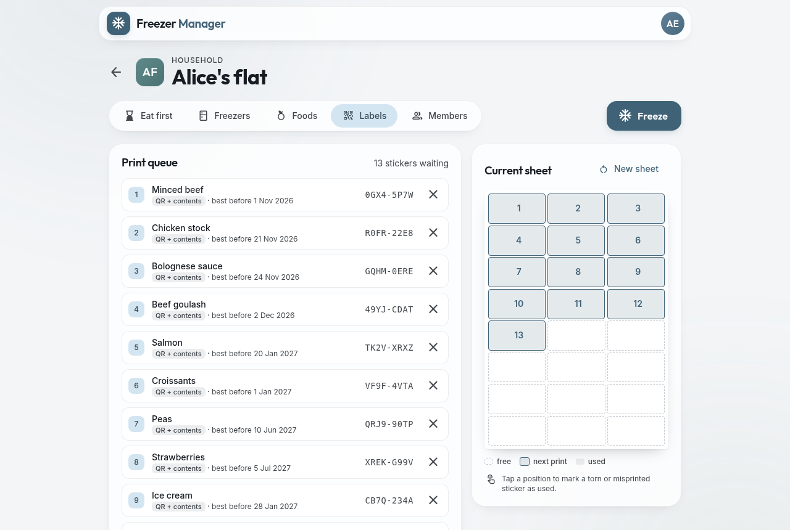
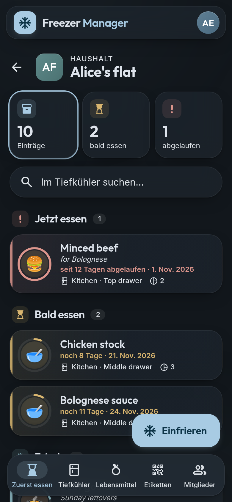
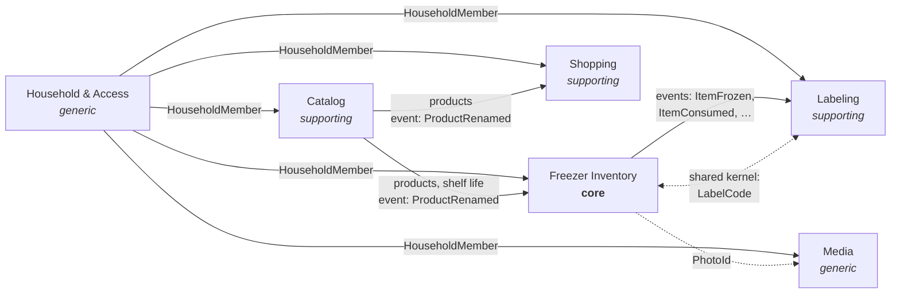

# ❄️ Freezer Manager

**A Domain-Driven Design showcase with Spring Boot, Spring Modulith and Angular** — a real app for
keeping track of what is in your freezers, small enough to read in an afternoon and rich enough to
show aggregates, value objects, domain events and several bounded contexts working together.

[](https://github.com/wbauer-dev/freezer-manager/actions/workflows/ci.yml)
[](LICENSE)




Households share their freezers. Everything that goes in gets a QR label and a best-before date
calculated from the food's shelf life; the **eat-first list** shows what should be eaten now and
soon. Scanning a label with any phone camera opens the item. Take out portions, undo a take-out,
discard what got freezer burn — and never again find a mystery box from two winters ago.

## Contents

- [Features](#features)
- [Screenshots](#screenshots)
- [A guided tour of the DDD patterns](#a-guided-tour-of-the-ddd-patterns)
- [Tech stack](#tech-stack)
- [Getting started](#getting-started)
- [Tests and code quality](#tests-and-code-quality)
- [Documentation](#documentation) · [Roadmap](#roadmap) · [Contributing](#contributing) · [License](#license)

## Features

- **Households** with several members; each user can belong to several households.
- **Freezers and drawers** — set up your freezers, reorder drawers by drag and drop, open a drawer
  to see what is in it.
- **Freeze** food with portions, optional weight and note; the best-before date follows from the
  category's shelf life unless you set it yourself.
- **Eat first:** everything in the freezers by urgency, with a freshness ring around each food.
- **Take out** portions (undo within 10 minutes), **discard** with a reason, full history per item.
- **Scan a label** with the app's scanner (or any phone camera) to see what is inside and take
  portions out right away.
- **QR labels** on A4 sticker sheets. The app remembers which positions of a sheet are used, so
  half-used sheets are not wasted. *Persistent* labels stay on a container and are reused for the
  next filling — pick one from the list of free labels, which shows what each one held last.
- **Photos** of the food — turned upright and scaled down in the browser, re-encoded without
  metadata on the server.
- **A catalog per household:** food categories with emoji and shelf life, and the household's
  products. Every member can change it, or start over — empty or with the system defaults.
- **A shared shopping list:** add foods from the catalog or anything else, tick them off in the
  shop, clear the basket afterwards. Adding the same thing twice adds up the quantities.
- **English and German**, prepared for more languages: user interface, error messages, printed
  stickers, the starter catalog and the login page.
- Light and dark mode, phone and desktop.

## Screenshots

| An item and its portions | The household's catalog |
|---|---|
|  |  |
| **Print queue and sticker sheet** | **On the phone — in German, dark mode** |
|  |  |

## A guided tour of the DDD patterns

The backend is a **modular monolith**: one Spring Modulith module per bounded context, each with
an onion architecture inside (`domain` → `application` → `web`/`persistence`). Tests verify the
module boundaries and the layering, so the structure cannot erode silently.



Where to look:

| Pattern | Example | What to notice |
|---|---|---|
| Bounded context as module | [`app.freezer.*`](backend/src/main/java/app/freezer) | Each top-level package is a context with its own database schema and migrations. [`ModularityTests`](backend/src/test/java/app/freezer/ModularityTests.java) fails on cycles or access to another module's internals. |
| Aggregate with real invariants | [`FrozenItem`](backend/src/main/java/app/freezer/inventory/domain/FrozenItem.java) | Taking out more portions than are left, or undoing someone else's take-out after 10 minutes, is impossible — the aggregate says no, not the controller. |
| Value objects | [`BestBefore`](backend/src/main/java/app/freezer/inventory/domain/BestBefore.java), [`Portions`](backend/src/main/java/app/freezer/inventory/domain/Portions.java), [`LabelCode`](backend/src/main/java/app/freezer/sharedkernel/LabelCode.java) | Immutable, self-validating, with behaviour (`statusOn(today)`, `takeOut(n)`). |
| Domain events between contexts | [`LabelLifecycle`](backend/src/main/java/app/freezer/labeling/application/LabelLifecycle.java), [`CatalogChanges`](backend/src/main/java/app/freezer/inventory/application/CatalogChanges.java) | Labeling reacts to Inventory's events, Inventory to Catalog's — after the commit, through Spring Modulith's event publication registry (an outbox). The publisher never calls the listener. |
| Shared kernel | [`LabelCode`](backend/src/main/java/app/freezer/sharedkernel/LabelCode.java) | The only model two contexts share, deliberately tiny. |
| Open host service | [`Catalog`](backend/src/main/java/app/freezer/catalog/Catalog.java), [`FrozenItemDirectory`](backend/src/main/java/app/freezer/inventory/FrozenItemDirectory.java) | Other modules get a small published API and read models, never the aggregates. |
| Access rules as types | [`HouseholdMember`](backend/src/main/java/app/freezer/household/HouseholdMember.java) | Only the Household module can create one, after checking membership. Use cases take it as a parameter, so the compiler enforces the tenant check. |
| One aggregate, many members | [`ShoppingList`](backend/src/main/java/app/freezer/shopping/domain/ShoppingList.java), [`ShoppingListManagement`](backend/src/main/java/app/freezer/shopping/application/ShoppingListManagement.java) | The household's whole list is one aggregate. Its commands are idempotent or merge ("500 g" + "1 kg"), so a change that collided with another member's is simply applied again to the fresh list. |
| Rules across aggregates | [`CatalogAdministration`](backend/src/main/java/app/freezer/catalog/application/CatalogAdministration.java) | Unique names and "only empty categories can be removed" live in the application service, backed by database constraints. |
| Ports and adapters | [`PhotoStorage`](backend/src/main/java/app/freezer/media/application/PhotoStorage.java) | Photos are stored in PostgreSQL behind a port; S3 would be another adapter. |
| A domain without texts | [`Translatable`](backend/src/main/java/app/freezer/sharedkernel/Translatable.java) | The domain reports problems as message codes; the web adapters translate them into the user's language. |

The full model — subdomains, context map, ubiquitous language, aggregates, flows and the decisions
behind them — is in [docs/domain-model.md](docs/domain-model.md).

## Tech stack

| | |
|---|---|
| **Backend** | Java 25, Spring Boot 4.1, [Spring Modulith](https://spring.io/projects/spring-modulith), [jMolecules](https://github.com/xmolecules/jmolecules) (DDD and architecture annotations), Spring Data JDBC, Flyway, PDFBox and ZXing for the label sheets |
| **Frontend** | Angular 22 (standalone components, signals, zoneless, signal forms), Angular Material 3, `@angular/localize` |
| **Infrastructure** | PostgreSQL 18, Keycloak 26 (OpenID Connect), Docker Compose |
| **Tests** | JUnit 5, Testcontainers, ArchUnit, Spring Modulith test support, Vitest |

## Getting started

Prerequisites: Java 25, Node 24, Docker.

```bash
docker compose up -d                      # PostgreSQL (5432) and Keycloak (8081)
cd backend && ./mvnw spring-boot:run      # API on http://localhost:8080
cd frontend && npm install && npm start   # app on http://localhost:4200
```

Open http://localhost:4200 and log in as `alice` / `alice` (also: `bob` / `bob`, `carol` /
`carol`), or register a new user on the login page. Keycloak's admin console is at
http://localhost:8081 (`admin` / `admin`). PostgreSQL and Keycloak listen on this computer only,
and Keycloak keeps its accounts in a volume, so `docker compose down` does not delete them
(`docker compose down -v` does).

**Or run everything in containers** — no Java or Node needed, only Docker:

```bash
docker compose --profile app up -d --build   # app on https://localhost:8443
```

The backend and the frontend are built from their Dockerfiles. nginx serves the app, the API and
the Keycloak login under one HTTPS address, with a self-signed certificate (your browser warns once).
Without `--profile app`, Compose starts only PostgreSQL and Keycloak for development.

To use the app from other devices — for example a phone that scans labels — copy `.env.example` to
`.env` and set `FREEZER_URL` to this computer's address, e.g. `https://192.168.1.20:8443`. Open the
app with exactly that address; login, the API and the QR codes on new stickers all use it. HTTPS is
required because the login uses the browser's Web Crypto API. Only the app's port is open to other
devices: nginx passes on the login pages, not Keycloak's admin console.

`.env.example` also starts Keycloak with a realm without the demo users and without the
`freezer-dev-cli` client (`KEYCLOAK_REALM_DIR=./infra/keycloak/lan`; development uses
`infra/keycloak/dev`), and lets you choose the passwords of the database and the admin console.
Keycloak imports the realm only into an empty volume — if it ran with the demo users before,
remove its data first: `docker compose down && docker volume rm freezer_keycloak-data`. Everyone
registers on the login page then; brute-force protection locks an account after repeated wrong
passwords.

> The default credentials in this repository are for local development only.

Scanning stickers with a phone needs this setup: in development the app runs on localhost, which a
phone cannot reach (and cannot log in to), so stickers printed there link to
`http://localhost:4200`. In containers, the QR codes follow `FREEZER_URL`.

## Tests and code quality

```bash
cd backend && ./mvnw verify                # needs Docker (Testcontainers)
cd frontend && npm test -- --watch=false
```

- **Domain tests** check aggregates and value objects as plain Java — no Spring, no database.
- **Module tests** bootstrap one module alone and verify the events it publishes or reacts to.
- **Integration tests** go from REST to PostgreSQL in a Testcontainer, with mocked JWTs.
- **Architecture tests** check module boundaries (Spring Modulith) and the onion layering
  (jMolecules + ArchUnit).
- **Translation tests** fail when a language misses a text.
- `./mvnw verify` also checks the code style (Checkstyle) and runs a static analysis (PMD);
  violations fail the build. Skip them while experimenting with `-Dcheckstyle.skip -Dpmd.skip`.

[GitHub Actions](.github/workflows/ci.yml) runs all of this on every push and pull request,
and also checks the frontend's formatting and that new texts were extracted for translation. It
builds both container images and checks nginx's configuration.

## Call the API with curl

In development, the realm has a client that hands out tokens for username and password:

```bash
TOKEN=$(curl -s -d client_id=freezer-dev-cli -d grant_type=password \
  -d username=alice -d password=alice \
  http://localhost:8081/realms/freezer/protocol/openid-connect/token | jq -r .access_token)

curl -H "Authorization: Bearer $TOKEN" http://localhost:8080/api/households
```

## Add a language

1. Frontend: add the language to `LANGUAGES` and its locale data to `LOCALE_DATA` in
   `src/app/core/i18n/languages.ts`, copy `public/i18n/messages.de.json` to
   `messages.<code>.json` and translate it; add it to `translations.spec.ts`.
2. Backend: add `<module>_<code>.properties` for every bundle in `src/main/resources/i18n/`
   (and to `LANGUAGES` in `MessagesTests`), and a starter catalog
   `src/main/resources/catalog/templates/<code>.json`.
3. Keycloak: add the language to `supportedLocales` in both realms, `infra/keycloak/dev/` and
   `infra/keycloak/lan/freezer-realm.json` (CI checks that they differ only in the demo users and
   the curl client).

The tests report missing translations.

## Documentation

- [Domain model](docs/domain-model.md) — bounded contexts, context map, ubiquitous language,
  aggregates and their rules, key flows, roadmap and decisions
- [Architecture](docs/architecture.md) — how the code is organised, which rules the tests
  enforce, and how to add a module

## Roadmap

1. ✅ Households, catalog, freezer inventory, labels, photos, English and German
2. A shared **shopping list** ✅ — next: live updates and staples that refill themselves when stock
   runs low
3. **Notifications** about food that should be eaten soon
4. **Recipes** — "what can I cook from my freezer?", with recipe import

Details in the [roadmap](docs/domain-model.md#7-roadmap).

## Contributing

Issues and pull requests are welcome. Please read the [domain model](docs/domain-model.md) and
the [architecture](docs/architecture.md) first: the ubiquitous language is used in code, API and
UI alike. Before opening a pull request, run `./mvnw verify` and `npm test -- --watch=false`;
new user-facing texts need an English and a German version.

## License

[Apache License 2.0](LICENSE)
