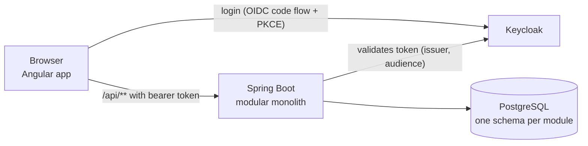

# Architecture

How the code is organised and which rules are enforced. The domain itself — bounded contexts,
context map, ubiquitous language — is described in [domain-model.md](domain-model.md).

## Overview



```
backend/    Spring Boot 4, Spring Modulith, Spring Data JDBC, Flyway
frontend/   Angular 22, Angular Material
infra/      Keycloak realm for local development
docs/       domain model and architecture
```

## Backend

### One module per bounded context

Every direct sub-package of `app.freezer` is a Spring Modulith application module and implements
one bounded context: `household`, `catalog`, `inventory`, `labeling`, `media`, `shopping` (later
`notifications`, `recipes`).

- A module's **base package is its published API**: identifiers, events and query interfaces
  that other modules may use. Sub-packages are internal.
- Modules talk to each other preferably through **events**. Spring Modulith stores every event
  publication in the `event_publication` table within the sending transaction (transactional
  outbox) and resubmits incomplete ones after a restart. A handled publication is deleted
  (`completion-mode: delete`); failed ones at least five minutes old are resubmitted every five minutes
  (`FailedEventResubmission`, in the application's base package next to the security configuration).
- A module reacts to another module's events with `@ApplicationModuleListener`: after the sender's
  transaction committed, asynchronously, in a transaction of its own. Example: Labeling follows
  Inventory (`ItemFrozen`, `ItemConsumed`, …) and never calls it. Reactions must tolerate events
  that don't apply (e.g. a release for a label that has moved on).
- **Events arrive late, twice and out of order**: listeners run concurrently, and a failed reaction is
  retried after later events were handled. Where the order matters, the sending aggregate counts its
  events and stamps the number on each one — a domain-level revision, known when the event is created,
  not the `@Version`, which is only known after saving. The receiving aggregate remembers the newest
  revision it applied and ignores an event that is not newer; that decision is a domain rule, not
  listener plumbing. Example: every `FrozenItem` event carries the item's revision, and a `Label`
  ignores stale events of its item (domain-model.md § 5.2).
- **Events evolve.** A publication may wait in `event_publication` while its event gains a component.
  `EventPublicationSerializer` (base package) reads such old publications with the component's default
  (`null`, `0`, `false`), where Spring Modulith's serializer would fail on a missing primitive. A new
  component's default must therefore mean "unknown" to the listeners (revision 0 is applied as it comes).
- `sharedkernel` holds the few types two contexts agree on and change together (currently
  `LabelCode`). Keep it small — everything added there couples its users.
- Dependencies between modules must not form cycles.

`ModularityTests` verifies these rules and writes module diagrams to
`backend/target/spring-modulith-docs`.

### Inside a module

```
household/
├── HouseholdId.java, UserId.java   published API
├── domain/                         @DomainRing          aggregates, value objects, repository interfaces
├── application/                    @ApplicationRing     use cases, transaction boundaries
├── web/                            @InfrastructureRing  REST controllers, request/response records
└── persistence/                    @InfrastructureRing  Spring Data JDBC implementations
```

The ring annotations (jMolecules, in `package-info.java`) make the onion architecture checkable.
`ArchitectureTests` enforces:

- Dependencies only point inwards: infrastructure → application → domain.
- jMolecules DDD rules, e.g. aggregates reference other aggregates only by identifier.
- The domain is plain Java. The only Spring types it may use are Spring Data annotations —
  metadata: mapping annotations (`@Table`, `@MappedCollection`, `@Embedded`, `@Version`) let
  Spring Data JDBC map the aggregate as a whole instead of maintaining a second persistence
  model; `@DomainEvents` lets the repository publish the aggregate's events when it is saved.

### Building blocks

| Concept | Implementation |
|---|---|
| Aggregate root | Class implementing jMolecules `AggregateRoot<T, ID>`; identity field annotated with `@Identity` |
| Identifier | Record implementing `Identifier` with a static `of(...)` factory, e.g. `HouseholdId(UUID id)`. Converted to and from database columns and path variables automatically (jmolecules-spring) |
| Value object | Record implementing `ValueObject`, immutable, validating itself, with behaviour where it fits (e.g. `Portions.takeOut(n)`, `BestBefore.statusOn(today)`). Mapped with `@Embedded` when it spans several columns |
| Entity inside an aggregate | Record implementing `Entity<Aggregate, Id>`, e.g. `Compartment` in `Freezer` |
| Domain event | Record implementing jMolecules `DomainEvent`, in the module's base package (published API). The aggregate collects events; Spring Data publishes them on `save()`; Spring Modulith records each publication in the `event_publication` table within the same transaction |
| Repository | Domain interface (`Households`) extending jMolecules `Repository`. The persistence adapter (`JdbcHouseholds`) extends it together with Spring Data's `Repository`; Spring Data implements CRUD methods, custom queries are declared with `@Query` |
| Optimistic locking | `@Version` on every aggregate. It also tells Spring Data whether an aggregate is new, because identifiers are assigned by the domain, not the database |
| Many members, one aggregate | The shopping list is one aggregate that several members change at once. Its commands are idempotent or merge, so `ShoppingListManagement` runs each in its own `TransactionTemplate` and applies a command that collided (optimistic lock, or two first inserts) again to the fresh list |
| Time | Use cases take the current time from the injected `Clock`; domain methods receive it as a parameter (`takeOut(..., now)`), so aggregates stay deterministic in tests |
| Rules spanning several aggregates | Checked in the application service and named as such, e.g. unique freezer names, "only empty compartments can be removed". Backed by unique indexes where races matter. Where no index fits, a row lock does: putting an item into a freezer and removing a compartment or the freezer load the freezer with `Freezers.findAndLock` (`select … for update`), so they run one after the other and the second sees what the first did |
| Read models | CQRS light: the application layer defines a query interface (`InventoryQueries`) returning read-only records; the persistence adapter implements it with plain SQL (`JdbcClient`). Domain rules are reused for derived values, e.g. the expiry status |

Validation lives in the domain (it is the source of truth). Request records repeat simple limits
with Bean Validation for early, friendly error messages.

### Persistence

- PostgreSQL with **one schema per module** (`household`, `inventory`, ...). Modules never join
  across schemas; they exchange data via events or published APIs.
- Migrations live with the module: `src/main/resources/db/migration/<module>/V1__....sql`. Spring
  Modulith runs them per module, each with its own Flyway history table
  (`flyway_schema_history_<module>`). `db/migration/__root/` holds shared infrastructure such as
  the event publication registry.

### REST API

- Commands are **task-based** and use the ubiquitous language: `POST .../items/{id}/take-out`,
  `.../undo-take-out`, `.../discard` — not a generic `PATCH` of the item.
- Everything inside a household lives below `/api/households/{householdId}/...`.
- Errors are RFC 9457 problem details. Each module translates its own exceptions in a controller
  advice: invalid values (`IllegalArgumentException`) → 400, unknown resources → 404, rule
  violations (e.g. `InventoryRuleViolation`) and concurrent changes (optimistic locking) → 409.
- The `detail` is in the user's language (see [Languages](#languages)).
- Catalog categories and products carry their `version` to the browser as an optimistic concurrency token: every
  change sends it back (in the body, or as the `version` parameter of a `DELETE`; required, else 400), and a change to
  an outdated version gets 409 with a specific message, also as the problem's `code` (`catalog.product.changed`), so
  nobody silently overwrites what another member changed. The application layer compares it (`ExpectedVersion`);
  `@Version` still guards the moment between loading and saving.

### Languages

- The domain contains no texts. Exceptions carry a **message code** (e.g. `inventory.item.not-in-freezer`)
  and, if needed, arguments (`sharedkernel.Translatable`, `InvalidValueException`).
- Each module has its own message bundle, `src/main/resources/i18n/<module>.properties` (English) and
  `<module>_de.properties`. The controller advices resolve codes with Spring's `MessageSource` and the
  request's `Accept-Language`. Bean Validation errors use Spring's `problemDetail.*` codes in `common`.
- Sticker texts and date formats in the label PDF come from the same bundles, in the language of the
  member who prints.
- The system defaults of the catalog are one JSON file per language (`catalog/templates/<language>.json`).
- `MessagesTests` checks that every language has every message and that every code in the code has a
  text; `JsonCatalogTemplatesTests` checks that all templates have the same categories.

### Security

- The backend is a stateless OAuth2 resource server. It accepts JWTs from the Keycloak realm
  `freezer` with audience `freezer-api`.
- The token subject is the user's identity (`UserId`). Controllers declare a `CurrentUser`
  parameter; it is resolved from the token.
- **Membership is a type.** Use cases inside a household take a `HouseholdMember` parameter. Only
  the Household module can create one (package-private constructor), after checking membership.
  Controllers simply declare the parameter: it is resolved from the `{householdId}` path variable
  and the token. A use case therefore cannot run for someone outside the household — the compiler
  enforces the check instead of a convention.
- Non-members get `404 Not Found`, so the API does not reveal which households exist.

### Tests

| Test | Checks |
|---|---|
| `ModularityTests` | Module boundaries, no cycles; generates module documentation |
| `ArchitectureTests` | Onion layering, DDD rules, plain-Java domain |
| `*Tests` next to the domain | Aggregates and value objects as plain unit tests — no Spring, no database |
| `*ModuleTests` | One module bootstrapped alone (`@ApplicationModuleTest`), other modules' APIs mocked. Spring Modulith's `Scenario` verifies published events — or, for a downstream module like Labeling, publishes the upstream events and waits for the reaction |
| `PdfLabelSheetRendererTests` | Prints a label, renders the page and decodes the QR code like a phone camera would |
| `*IntegrationTests` | REST → use case → aggregate → PostgreSQL (Testcontainers), with mocked JWTs |

## Frontend

- Angular 22: standalone components, zoneless change detection, signals. Queries use
  `httpResource`, forms use signal forms.
- **Feature folders follow the bounded contexts**: `household`, `catalog`, `inventory`, `labeling`,
  `media`, `shopping`. Each folder holds its API service, models and pages.
- When a user action concerns two contexts, the UI coordinates the commands. Example: freezing a
  food the catalog doesn't know yet first adds the product (Catalog), then freezes the item
  (Inventory). Neither backend module calls the other's commands.
- Login with `angular-auth-oidc-client` (authorization code flow with PKCE). An interceptor adds the
  access token to calls to `/api/`. The dev server proxies `/api` to the backend on port 8080.
- When the session has ended — the token can no longer be renewed, or the API answers 401 — `SessionExpiry` starts a
  new login and brings the user back to the same page (at most once per navigation, and not again before the API
  has accepted a call, so a backend that rejects every token cannot cause a login loop).
- Angular Material with a custom Material 3 theme ("Fjord": cool neutrals, one muted steel-blue accent,
  frosted-glass surfaces; light and dark mode follow the system). Palette seeds are in
  `src/styles/_theme-colors.scss`, design tokens in `src/styles.scss`. Status colours carry meaning: muted teal
  for fresh, ochre for "eat soon", brick red for expired.
- Food emojis are toned down by one token, `--food-emoji-filter` in `src/styles.scss`. Anything that shows a
  food's emoji puts it in an element with the `food-emoji` class (or adds the token to its own `filter`).
- CSS `light-dark()` only accepts colours. Shadows and gradients that differ between light and dark mode are
  switched in the `prefers-color-scheme: dark` block of `src/styles.scss`.
- Photos need the access token, which an `` cannot send. `PhotoLoader` loads them through
  `HttpClient` and shows them as object URLs, once per session (photos never change). Only the last few
  large photos are kept; a photo that could not be loaded is tried again the next time it is shown.
- Pages compose data from several contexts where the user needs it, e.g. the eat-first list (Inventory)
  shows each item's category emoji by looking up the product (Catalog) — the backend modules stay separate.
- The **scanner** (`labeling/scanner-page.ts`) reads QR codes with the browser's `BarcodeDetector` where it supports
  QR codes (Chrome on Android) and with the jsQR library elsewhere, loaded only then. Camera access needs HTTPS or
  localhost.
- Motion respects `prefers-reduced-motion`; page changes use the View Transitions API (food avatars morph from
  the list into the item page).
- **Languages** use Angular's built-in i18n (`@angular/localize`) with translations loaded at runtime: `main.ts`
  loads `public/i18n/messages.<language>.json` before importing the app, then sets `LOCALE_ID` (dates, numbers).
  Texts in templates carry `i18n="@@id"` with a stable custom id, texts in code use `` $localize`:@@id:…` ``;
  plurals are ICU expressions. The language is the one chosen in the account menu (stored in the browser),
  otherwise the browser's. Switching reloads the app. An interceptor sends it as `Accept-Language` to the
  backend, and Keycloak gets it as `ui_locales`, so the login page matches.
- After changing texts, `npm run i18n:extract` updates the English source `src/locale/messages.json`;
  `translations.spec.ts` fails until every language has translated every message with the same placeholders.

## Adding a module

1. Create `app.freezer.<module>` with a `package-info.java` carrying `@ApplicationModule` and a
   short description of the bounded context.
2. Add the sub-packages `domain`, `application`, `web`, `persistence` with their ring annotations.
3. Add `db/migration/<module>/V1__<module>.sql`, starting with `create schema if not exists <module>;`.
4. Put published types (identifiers, events) in the module's base package.
5. Add a feature folder and routes in the frontend.
