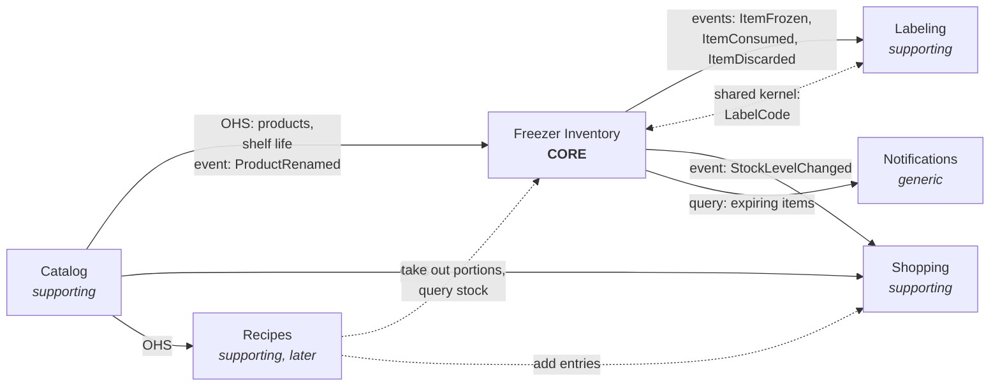
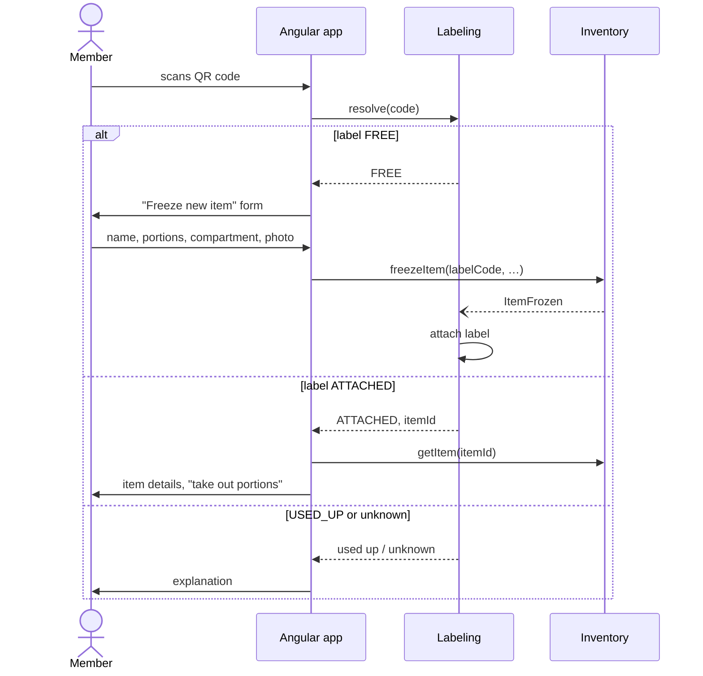

# Freezer Manager — Domain Model

> Status: **phase 1 complete** — Household & Access, Catalog (one per household, editable),
> Freezer Inventory, Labeling and Media are implemented, in English and German. Phase 2 (Shopping) has started:
> the shared shopping list is implemented; live updates and staples are next. Decisions are recorded in [§ 8](#8-decisions).
> How the code is organised is described in [architecture.md](architecture.md).

## 1. Vision

Households keep track of what is in their freezers. Every frozen item carries a QR label, so
anyone in the household can scan a package and immediately see what it is, when it was frozen
and when it should be eaten. The app tells you what to eat first, keeps a shared shopping list
filled with the staples that are running low and — later — suggests recipes that use up what is
in the freezer.

The project is a **DDD showcase**: Spring Boot, PostgreSQL, Angular. The domain is deliberately
small and familiar so that the focus stays on the modelling techniques.

## 2. Subdomains and bounded contexts

| Bounded context | Subdomain type | Responsibility | Phase |
|---|---|---|---|
| **Freezer Inventory** | **Core** | Freezers, compartments, frozen items, portions, best-before, stock | 1 |
| Labeling | Supporting | QR labels: issuing, printing, scan resolution | 1 |
| Catalog | Supporting | Products and food categories with recommended shelf life | 1 |
| Household & Access | Generic | Households, members, roles, invitations; login delegated to an IdP | 1 |
| Media | Generic | Photo upload, thumbnails, storage | 1 |
| Shopping | Supporting | Shared shopping list, staples (minimum stock) | 2 |
| Notifications | Generic | "Expiring soon" reminders | 3 |
| Recipes | Supporting | Recipes, "what can I cook from my freezer", import | 4 |

Generic subdomains are implemented as simply as possible (or bought, e.g. the identity
provider). Modelling effort goes into the core.

## 3. Context map

Not drawn, because they relate to every context:

- **Household & Access** is upstream of all contexts. Every aggregate carries a `HouseholdId`
  (the tenant key); downstream contexts are conformist to it.
- **Media** is referenced by `PhotoId` only. No context depends on Media's model.

Relationships:

| Upstream → Downstream | Pattern | Notes |
|---|---|---|
| Catalog → Inventory, Shopping, Recipes | Open Host Service | Published module API; downstream reads products and shelf life |
| Catalog → Inventory | Published events | `ProductRenamed`: items still in the freezer take the new name |
| Inventory → Labeling | Published events, Labeling is conformist | Labeling learns about attached/released labels from item events |
| Inventory → Labeling | Open Host Service (query) | `FrozenItemDirectory`: name and dates for contents stickers |
| Inventory ↔ Labeling | Shared Kernel | Only the `LabelCode` value object (format, generation, validation) |
| Inventory → Shopping | Published events | `StockLevelChanged` hides items and portions — Shopping only sees "product X, n portions" |
| Inventory → Notifications | Query API | Expiring-soon read model |
| Recipes → Inventory, Shopping | Customer–Supplier | Recipes issues commands; it translates grams/pieces into portions |
| External recipe sites → Recipes | Anti-Corruption Layer | schema.org/Recipe JSON-LD import |

Module dependencies form a DAG (no cycles): Inventory must never call Labeling or Shopping.

## 4. Ubiquitous language

| Term | Meaning |
|---|---|
| **Household** | Group of members sharing freezers and a shopping list. All data belongs to exactly one household. |
| **Member** | A user in a household, with role *Owner* or *Member*. |
| **Freezer** | A physical freezer of a household. Has one or more compartments. |
| **Compartment** | A drawer or shelf in a freezer. |
| **Frozen item** | One physical package or container in a freezer. Carries one label. |
| **Portion** | Countable part of a frozen item that can be taken out on its own. |
| **Freeze** | Put a new frozen item into a freezer. |
| **Take out** | Remove one or more portions. Final — no refreezing. |
| **Withdrawal** | Record of one take-out: how many portions, by whom, when. |
| **Consumed** | A frozen item whose last portion was taken out. |
| **Discard** | Remove an item without eating it (expired, freezer burn, …), with a reason. |
| **Frozen on** | Date the item was frozen. |
| **Best-before** | Date by which the item should be eaten. Calculated from the shelf life unless overridden. |
| **Shelf life** | Recommended freezer storage duration of a food category, e.g. minced meat 3 months. Each household can change it. |
| **Expiring soon** | Best-before within the household's warning period (default 14 days). |
| **Eat first** | Items in the freezer, ordered by best-before. |
| **Label** | The identity behind a QR code, attached to one frozen item at a time. *One-time* (e.g. on a bag, used up with its item) or *persistent* (stays on a container, lid or bag clip; free again for the next filling). |
| **Sticker** | What is printed on one position of a sticker sheet: QR only, QR + contents, or contents only. |
| **Label code** | Short unique code encoded in the QR and printed in readable form. |
| **Scan** | Reading a label code. What happens next depends on the label's state. |
| **Product** | A kind of food in the household catalog, e.g. "Peas", "Beef goulash". |
| **Food category** | Grouping of products with an emoji and a recommended shelf life, e.g. Minced meat 🍔 3 months. |
| **Catalog** | A household's food categories and products. Every member may change it. |
| **System defaults** | Starter catalog per language (categories with typical products) that a catalog starts with, or starts over with. |
| **Start over** | Replace the whole catalog: empty, or with the system defaults in a chosen language. |
| **Stock** | Portions of a product currently in the household's freezers. |
| **Staple** | Product with a minimum stock. Falling below it puts the product on the shopping list. |
| **Shopping list** | The household's shared list of entries to buy. |
| **Entry** | One thing to buy. Source: *manual*, *low stock* or *recipe*. *Open* until a member ticks it off. |
| **Basket** | The entries ticked off while shopping. They leave the list when the shopping is *done*. |

## 5. Bounded contexts in detail

### 5.1 Freezer Inventory (core)

**Aggregate `Freezer`**

- `FreezerId`, `HouseholdId`, name, list of `Compartment` (id, name, position)
- Invariants: one to 20 compartments; compartment names unique within the freezer (ignoring
  case). Freezer names are unique per household — checked by the application service, backed by
  a unique index.
- A compartment can only be removed when it is empty. This is checked by the application service
  — a deliberate cross-aggregate check, not an aggregate invariant (the freezer would have to
  load all items to know).
- Compartments can be rearranged (drag and drop in the UI). The new order must name every
  compartment exactly once.
- A freezer can only be removed when it is empty (same cross-aggregate check). A removed freezer
  is kept, not deleted: items that were stored in it keep their history ("Kitchen · Top drawer").
  It disappears from all lists, rejects every change, and its name can be used again.

**Aggregate `FrozenItem`**

| Field | Type |
|---|---|
| `FrozenItemId`, `HouseholdId` | identity, tenant |
| `Location` | value object: `FreezerId` + `CompartmentId` |
| `ProductId` + product name | every item is of a product; the name is a snapshot taken when freezing |
| `LabelCode` | shared kernel value object — *added together with Labeling* |
| `Portions` | remaining / initial |
| `FrozenOn`, `BestBefore` (+ *calculated* or *overridden*) | dates |
| optional weight per portion, note, `PhotoId` (*with Media*) | |
| `Withdrawal` value objects | portions, member, timestamp — needed for undo and history |
| state | `IN_FREEZER` → `CONSUMED` or `DISCARDED` |

Invariants and rules:

1. While `IN_FREEZER`, at least one portion remains; you can't take out more portions than remain.
2. **No refreezing:** taken-out portions can't be put back. Only exception: the member who
   took them out may undo their latest withdrawal within 10 minutes (wrong item scanned).
   If that withdrawal consumed the item, it only comes back while its compartment still exists
   (its freezer is not removed) and its label is not on another item by now (rule 6).
3. Taking out the last portion makes the item `CONSUMED`.
4. `BestBefore` is not before `FrozenOn`.
5. Consumed and discarded items are read-only.
6. Within a household, a label code belongs to at most one item that is `IN_FREEZER`
   (enforced by a partial unique index). The application service checks it when freezing, and
   when an undo would bring a consumed item back — it looks up whether another item carries the
   label, and the item refuses the undo if so. Inventory only knows the codes on items still in
   the freezer: it would accept the code of a `USED_UP` one-time label sent through the raw API,
   and Labeling would then report a conflict. Inventory can't ask Labeling, because that would
   create a module cycle.
7. The location must be a freezer of the same household (checked by the application service).

**Shelf-life policy (`BestBefore.calculate`):** best-before = frozen on + shelf life of the
product's food category, which Inventory gets from Catalog's published API. The member can
override the result.

**Expiry status (`BestBefore.statusOn(today)`):** *expired* after the best-before date,
*expiring soon* within the warning period (14 days for now; will become a household setting),
otherwise *fresh*. The eat-first read model uses the same rule.

**Domain events** (published API of the module): `ItemFrozen`, `PortionsTakenOut`,
`TakeOutUndone`, `ItemConsumed`, `ItemDiscarded`. Later: `ItemMoved`, `StockLevelChanged`.

**Read models:** eat-first list, item counts per compartment. Later: stock per product.

`StockLevelChanged(householdId, productId, portionsInStock)` will be published by a stock
projection inside Inventory once Shopping needs it (phase 2). It is the published language for
downstream contexts: they never see items or withdrawals.

### 5.2 Labeling (supporting)

A **label** is only an identity: the code behind a QR code. What gets printed is decided per
**sticker**, so the same label can be printed once as a QR code and later get a sticker that
says what is inside.

**Aggregate `Label`**

- `LabelCode` (identity), `HouseholdId`, kind `ONE_TIME | PERSISTENT`, state
  `FREE | ATTACHED | USED_UP`, attached (or last) `FrozenItemId`. No print text.
- Transitions, all driven by Inventory events:

| Event | One-time label | Persistent label |
|---|---|---|
| `ItemFrozen` | created as `ATTACHED` | `FREE` → `ATTACHED` |
| `ItemConsumed` / `ItemDiscarded` | `ATTACHED` → `USED_UP` | `ATTACHED` → `FREE` |
| `TakeOutUndone` | back to `ATTACHED` | back to `ATTACHED`, unless it is already on another item |

- **One-time labels** are for things that are thrown away, like freezer bags. A new one's sticker
  goes straight into the print queue.
- **Persistent labels** stay on a container, lid or bag clip and are used for many fillings. They
  are created in batches and printed once. The app knows what is inside; the freeze page offers
  them first when the household has free ones.

**Value object `Sticker`** — one entry of the print queue, a snapshot taken when it is queued:

| Layout | Printed | Used for |
|---|---|---|
| `QR_ONLY` | QR code and label code, "scan to see what's inside" | persistent labels |
| `QR_AND_CONTENT` | QR code with name, frozen on, best-before | one-time labels |
| `CONTENT_ONLY` | name and dates, no QR code | what is inside a container with a persistent label |

The name and dates come from Inventory: for a new item from `ItemFrozen`, otherwise from
Inventory's published query API `FrozenItemDirectory`. The same label is queued at most once per
layout.

**Aggregate `LabelSheet`** (one per household)

Labels are printed on A4 sticker sheets (format configurable, default 3 × 8 labels of 70 × 37 mm).
Printing a whole sheet for a single label would waste the rest, so the household keeps track of
its current sheet:

- Positions already used on the current sheet are remembered; new labels go to the next free
  positions. A partly used sheet simply goes through the printer again.
- Labels waiting to be printed are collected in a **print queue**, e.g. on a cooking day: freeze
  six boxes, then print all six labels in one go.
- When the sheet is full, printing continues on a new sheet. Members can start a new sheet
  manually or mark positions as unusable (torn, misprinted).
- **Scan resolution:** `FREE` → offer "freeze new item"; `ATTACHED` → show the item;
  `USED_UP` → "label already used, consumed on …"; unknown or belongs to another household →
  "unknown label" (never reveal other households' labels).

**Label code** (shared kernel of Inventory and Labeling): 8 characters Crockford Base32 (≈ 40
bits, no ambiguous characters), printed as `K7Q2-M9XA`. Typed codes are read leniently (case,
dashes, I/L → 1, O → 0). Inventory generates the code of a new one-time label when an item is
frozen; Labeling generates the codes of persistent labels. The QR encodes a URL
(`https://<host>/s/K7Q2M9XA`), so any phone camera opens the app directly. The app's own
scanner reads the same codes — from any host, so stickers printed under an earlier address keep
working — and shows the food right away, ready to take portions out and scan the next label.

**Why Labeling is downstream only:** a label sits physically on one package, so two members
attaching the same label at the same moment practically can't happen. Instead of a synchronous
check across contexts, Labeling follows Inventory's events. If it ever receives `ItemFrozen` for
a label that is already attached (or belongs to another household), it reports a conflict for
manual resolution — for now as a log entry, later as a `LabelConflictDetected` event. The freeze
page additionally checks a typed or scanned code before freezing.
*(Showcase point: ask the domain how likely a race really is before engineering it away.)*

### 5.3 Catalog (supporting)

Each household has its own catalog; every member may change it.

- **Aggregate `FoodCategory`**: `FoodCategoryId`, `HouseholdId`, name (unique per household,
  case-insensitive), emoji, recommended shelf life (1–60 months), position. A new shelf life applies
  to food frozen from then on; items in the freezer keep their best-before date.
- **Aggregate `Product`**: `ProductId`, `HouseholdId`, name (unique per household, case-insensitive),
  category of the same household. Renaming publishes `ProductRenamed`. *Later:* default portion
  description and photo.
- **Aggregate `HouseholdCatalog`**: when and how the catalog started — with the system defaults in
  a language, or empty. Its existence marks the catalog as started.
- **Rules across aggregates** live in the application service `CatalogAdministration`: unique
  names (backed by unique indexes) and "only categories without products can be removed".
- **System defaults** are one JSON file per language (`catalog/templates/<language>.json`); all
  languages have the same categories and shelf lives (guarded by a test). A household's catalog
  starts with them in the language of the member who first opens it; there is no copy of the
  defaults in the database.
- **Start over** removes all categories and products and starts empty or with the defaults in any
  language. Items in the freezer keep their names and best-before dates — Inventory stores both.
- Products are created on the fly: when a member freezes something the catalog doesn't know yet,
  the UI first adds the product (with a category), then freezes the item.
- Exposed to other contexts as an Open Host Service: `Catalog.findProduct(household, product)`
  returns a `ProductDescription` (id, name, shelf life) — never the aggregates.

### 5.4 Household & Access (generic)

- **Aggregate `Household`**: name, members (`UserId`, role), invitations (single use, expire
  after 7 days), warning period for "expiring soon".
- Invariants: at least one owner; only owners invite or remove members.
- Login, passwords and accounts are delegated to an identity provider — not modelled.
- Tenant isolation: the application layer resolves the current household from the request and
  checks membership before any use case runs.

### 5.5 Shopping (supporting, phase 2)

- **`ShoppingList`** ✅ – one per household, identified by the `HouseholdId`, created when it is first changed.
  Entries: a catalog product (with a snapshot of its name) or free text, an optional quantity note, the source
  (`MANUAL` now; `LOW_STOCK`, `RECIPE` later), added by, checked by/at (member names are snapshots).
- Rules ✅:
  - At most one *open* entry for the same thing – the same product, or free text with the same name ignoring case.
    Adding it again merges the quantity notes: "500 g" and "1 kg" become "500 g + 1 kg". An entry in the basket
    doesn't count, so buying something again gives a new entry.
  - Unticking an entry when the same thing was added again in the meantime merges the two.
  - Ticking off, unticking and removing are idempotent; an entry that is gone is ignored (another member may have
    been quicker).
  - "Done shopping" removes everything in the basket.
  - Name and quantity at most 60 characters each, at most 200 entries – the list is loaded and saved as a whole.
  - Free text never becomes a catalog product: milk doesn't belong in the freezer catalog.
  - Product names follow the catalog (`ProductRenamed`); a product removed from the catalog keeps its last name.
- **Concurrent changes:** two members changing the list at the same moment collide on its version. Because the
  commands are idempotent or merge, the application service simply applies a collided command again to the fresh
  list (up to three times) – see decision 26.
- **`Staple`** (next): `ProductId` + minimum portions.
  - `StockLevelChanged` below the minimum and no open entry → add a `LOW_STOCK` entry.
  - Stock back at or above the minimum and the `LOW_STOCK` entry still unchecked → remove it.
- Changes are pushed live to all members viewing the list (server-sent events) (next).

### 5.6 Notifications (generic, phase 3)

Daily job: query Inventory's expiring-soon read model and send each member a digest (in-app and
e-mail; web push later). Members can switch it off.

### 5.7 Recipes (supporting, phase 4)

- **`Recipe`**: title, servings, ingredients (name, amount, unit, optional `ProductId`),
  steps, photo, source URL.
- "What can I cook from my freezer?" and "recipes that use up items expiring soon".
- "Cook this": take out matching portions in Inventory, add missing ingredients to the shopping
  list (source `RECIPE`).
- **Different model of the same food:** a recipe needs "500 g minced beef", the freezer holds
  "2 portions minced beef". Recipes translates between the two — this needs a weight per
  portion (see decisions, § 8).
- Import from websites via schema.org/Recipe JSON-LD behind an anti-corruption layer.

### 5.8 Media (generic)

Deliberately thin. `Photo` holds only metadata (household, size, who uploaded it, when); the image
data of its two variants — *large* (≤ 1600 px) and *thumbnail* (≤ 400 px) — is kept by a storage
adapter, so loading the aggregate never loads megabytes.

- The browser turns a photo the right way up (phones store the orientation separately) and scales
  it down before uploading.
- The server decodes and re-encodes every upload. That rejects anything that is not an image and
  strips all metadata, including the location phone cameras embed.
- Other contexts keep a `PhotoId` only and ask `MediaLibrary.contains(household, photo)` before
  using one. A frozen item can get a photo when it is frozen or later, while it is in the freezer.
- Photos never change; browsers may cache them for a year.

## 6. Key flows

### Scan a label

### Freeze with a new printed label

1. Member fills in the freeze form without scanning and chooses "print label".
2. Inventory generates a new `LabelCode`, creates the `FrozenItem`, publishes `ItemFrozen`.
3. Labeling creates a one-time label in state `ATTACHED` and adds it to the print queue.
4. The member prints right away (the label lands on the next free position of the current
   sheet) or first freezes more items and prints them together.

### Take out the last portion

1. `FrozenItem.takeOut(n)` → `PortionsTakenOut`, remaining 0 → `ItemConsumed`.
2. Labeling: one-time label → `USED_UP`; persistent label → `FREE` (ready for the next filling).
3. Stock projection recalculates → `StockLevelChanged`.
4. Shopping: product is a staple and below minimum → `LOW_STOCK` entry appears for everyone.

## 7. Roadmap

| Phase | Scope | Result |
|---|---|---|
| 1 ✅ | Household & Access, Catalog (minimal), Inventory, Labeling, Media | Usable freezer with labels, scanning, photos, eat-first list |
| 2 (started) | Shopping | Shared live shopping list ✅, live updates, staples |
| 3 | Notifications | Expiry reminders |
| 4 | Recipes | Cook from freezer, recipe import |

## 8. Decisions

1–11 agreed on 2026-11-13. 12–20 and 26–28 were decided during implementation and are open for review.

| # | Topic | Decision |
|---|---|---|
| 1 | Shopping list | Personal list, shared by all members of a household |
| 2 | Tenancy | Several households, each with its own members |
| 3 | Labels when freezing | Print a new one-time label, or scan an existing persistent label on a container |
| 4 | Label printing | A4 sticker sheets; used positions and print queue tracked per household (§ 5.2) |
| 5 | Recipes | Wanted, as phase 4 |
| 6 | Identity provider | Keycloak (docker-compose) — login is a generic subdomain, use it instead of building it |
| 7 | Persistence | Spring Data JDBC: aggregates are mapped as a whole, one repository per aggregate root, no lazy loading |
| 8 | Quantity of a frozen item | Portions + optional weight per portion (Recipes needs it) |
| 9 | Consistency boundary of the shopping list | Whole list is one aggregate — revisit if conflicts show up |
| 10 | Tenant isolation | Membership checks in the application layer; Postgres row-level security possible later as a second line of defence |
| 11 | Several households per user | Yes (e.g. own flat and parents' house) |
| 12 | Product of a frozen item | Required (was optional in the first draft). Leftovers become products too, e.g. "Beef goulash"; this keeps shelf life and stock meaningful for every item |
| 13 | "Expiring soon" warning period | 14 days, fixed for now; becomes a household setting later |
| 14 | "Today" for expiry | Server time zone; dates entered by members (frozen on, best before) are taken as entered |
| 15 | Items frozen before labels existed | Keep no label; every newly frozen item gets one |
| 16 | Uniqueness of label codes | Random 40-bit codes, unique in practice; Inventory prevents the same code on two items in the freezer, Labeling reports the rare conflict |
| 17 | Sheet format | 3 × 8 labels of 70 × 37 mm on A4, fixed for now; becomes a household setting later |
| 18 | Photo storage | PostgreSQL behind a storage port — one container less; S3/MinIO would be another adapter |
| 19 | Photo processing | Browser fixes orientation and scales down; server re-encodes (validation, no metadata) and makes the thumbnail |
| 20 | Unused photos | Photos uploaded but never attached to an item are kept for now; a clean-up job comes later |
| 21 | Labels vs. stickers | A label is only the identity (QR code); what is printed is a sticker with one of three layouts. "Reusable" labels are now called *persistent* (agreed 2026-11-13) |
| 22 | Catalog ownership | One catalog per household, categories included; every member may change it, no extra role (agreed 2026-11-13) |
| 23 | Starting a catalog | Lazily, with the system defaults in the language of the first member who opens it; start over empty or with the defaults in any language (agreed 2026-11-13). Existing data was migrated: households with products kept the former global categories |
| 24 | Renamed products | Items still in the freezer take the new name (event `ProductRenamed`); eaten and discarded items keep their history |
| 25 | Languages | English and German, prepared for more (agreed 2026-11-13). The domain reports problems as message codes; the web adapters translate them (Accept-Language). Food names are household data and are not translated |
| 26 | Concurrent changes to the shopping list | The whole list stays one aggregate (decision 9). A command that collided with another member's change is applied again to the fresh list, up to three times; this is safe because the list's commands are idempotent or merge |
| 27 | Free text on the shopping list | Allowed, and never added to the catalog – the catalog describes what goes into the freezer |
| 28 | Product names on the shopping list | A snapshot taken when the entry is added, kept current through `ProductRenamed` (like frozen items, decision 24) |
